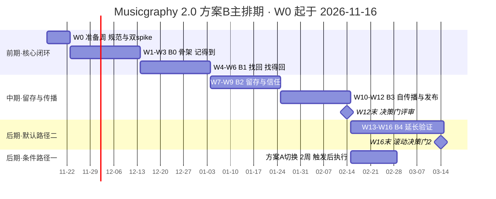

# Musicgraphy 2.0 · PM 排期总纲与研发可持续性计划

> 版本 v1.0 · 编制日期 2026-11-11 · 编制角色:PM(项目经理)
> 性质:把既有文档(产品理念终稿 / PRD / 数据模型 / 路线图 A·B / 04A·04B / 07-ADR)中的**全部需求**,翻译为带日历锚点、带质量门禁、带后期分支的执行排期。
> 冲突处理:不推翻任何既有裁决与路线图;本文新增项一律标注「PM 补充」。文档冲突时以《产品理念终稿》与《PRD》为准。

---

## 0. 一页速览

| 项 | 内容 |
|---|---|
| 执行主线 | 方案 B(增长验证优先):12 周验证冲刺 + 决策门;方案 A 为切换预案 |
| 排期口径 | 日历周(周一~周日);W0 = 2026-11-16 起算(11-11 为周三,当周余量用于启动) |
| 三段式 | **前期 W0–W6「记得到 + 找得回」→ 中期 W7–W12「留得住 + 传得开」→ 后期 W13+ 决策门三分支** |
| 贯穿约束 | 三条不变红线 · §16 优先序(Find→Record→Organize→Review)· 复杂度硬约束一票否决 |
| PM 补充纪律 | ① 质量门禁先于功能;② 阶段内冻结需求;③ 拓展点随功能绑定落地周,不留悬空的架构决定 |

**日历注意**:W11–W12 横跨 2027 春节(正月初一约为 2027-02-06,落于 W11)。对外发布窗口已内置顺延弹性(见 §4.2);决策门评审为内部动作,照常执行。

---

## 1. 排期总原则(继承 + 三条新增纪律)

**继承自上游文档**(原文有效,此处只重申):
1. 权重模型:方案 B = Q 0.40 / V 0.30 / G 0.25 / M 0.05;复杂度 C 为硬约束,不进权重、一票否决(00-README §一)。
2. 优先序准绳:Find → Record → Organize → Review(AGENTS.md §16),任何排期争议按此仲裁。
3. 三条不变红线全程有效:核心闭环永久免费 / 全量导出永久免费 / 无打扰变现。
4. W1–W6 与路线图 A 完全一致(Q 权重最高,核心闭环不为任何目标让路,03-路线图B)。

**PM 补充的三条排期纪律**(本文新增,依据:路线图 A「W3 压测不过不进下一阶段」惯例的推广 + AGENTS.md §14/§15):
1. **质量门禁先于功能**:每阶段 DoD = 功能验收 + 六项门禁(tsc / lint / build / 三态 / 性能预算 / RSS<100MB),任一不过不进下阶段。
2. **阶段内冻结需求**:阶段进行中不接受新需求插入;新想法一律走准入流水线(§10),排入下一阶段边界或观察池。防 AI 生成与协作场景下的范围蔓延。
3. **拓展点随功能落地**:凡"今天写不要钱、以后写要迁移"的决定(user_id 列、精度字段、flag、API 版本号等),绑定到具体周执行,不允许"以后再说"。

---

## 2. 需求全景盘点(统一需求池)

编号规则:产品需求沿用上游 ID(FR-x / P1-x / D1-D3);工程需求 ADR-001~007;PM 新增需求 PM-01 起。每条标注:来源 · 收敛度 · 排期位置 · **拓展点**(后期扩展性的落点)。

### 2.1 P0 共识骨架(六件套)——前期 W0–W3 / W6

| ID | 需求 | 来源·收敛度 | 排期 | 拓展点(为谁预留) |
|---|---|---|---|---|
| FR-1 | 记录路径:三捷径 + 确认层三件套 | PRD §3 · 4/5 | W1–W2 | 重复→409 转化提示为 P1-7 重听动作预留显式出口;Note placeholder 文案即裁决案 2 |
| FR-2 | 渐进式筛选舱 chips + 实时计数 | PRD §3 · 4/5(全场最不可返工) | W4 | URL 即状态(ADR-003)→ 筛选态可分享/可回退;query 结构为 P1-4 色板轴、P1-10 命名视图预留 |
| FR-3 | 全文检索 Note/Tag/标题/艺术家 | PRD §3 · 5/5 | W5 | LIKE 实现从架构上封死搜索引擎引入路径;P1-9 歌名反查复用同一入口 |
| FR-4 | 数据决定三条(D1 listenedAt / D2 集合语义 / D3 封面主色) | PRD §3 · 5/5 | **W1 随建表落死** | D1+`listened_precision` 粒度字段 → 听的时期轴 / 那年今日 / 未来收听史(观察池);D3 → P2 色环墙;D2 → `UNIQUE(user_id,album_id)` 物理约束 |
| FR-5 | 规模底座:封面网格 + 虚拟滚动 + 5000 张 <1s | PRD §3 · 5/5 | W2–W3 | `LIMIT 60` 分页 = 内存纪律①;密度三档扩展留后续 |
| FR-6 | 验收口径(全 P0 完成定义) | PRD §3 · 5/5 | 全程门禁 | 口径数值直接转为回归测试断言(PM-02) |

### 2.2 P1 第一梯队(含方案 B 三处调整)

| ID | 需求 | 来源·收敛度 | 排期 | 拓展点 |
|---|---|---|---|---|
| P1-1 | "一年前的今天"回响卡片 | 案 2 · 5/5 | W7 | `/api/echo/today` 无则 204 协议;确定性锚,永不做推送(支柱四) |
| P1-2 | 详情页"记忆条" | 3/5 独立发明合并 | W7 | 零新数据纯视图重组;为 P1-5 联想入口预留版位 |
| P1-3 | 档案导出(JSON/CSV,永久免费) | 4/5 | W8(B 前置) | 导出格式含 `version` 字段 → 未来格式演进向后兼容;导出即备份(RPO 验收) |
| P1-4 | 色板筛选 UI | 案 5 · 3/5 | W6(B1 内含颜色) | 与 P2 色环/光谱墙**共用同一份 cover_color 索引**(双用途范本) |
| P1-5 | 联想入口(同期/同天/同 Tag) | 2/5 | W8 | 零新数据;是"联想边"(观察池)的零成本替身,信号出现即升级 |
| P1-6 | Tag 轻治理(合并提示) | 2/5 | W9 | `normalized_name` 列已在 P0 建表时预置,治理零迁移 |
| P1-7 | 重听动作("又听了一次") | 3/5 | W8 | D1/D2 的落地界面;同时是"收听史事件表"(观察池)的信号采集点 |
| P1-8 | 键盘流(/ / Enter / F) | 2/5 | W9 | 可访问性基线的一部分 |
| P1-9 | 歌名反查专辑 | 1/5 | **W9 弹性位**(首个可顺延项,B4 兜底) | 复用 FR-3 搜索入口,零新概念 |
| P1-10 | 命名视图(只存查询状态) | 案 4 · 2/5 | W9 | `saved_views.query_json` 是"Era 语言"(观察池)的数据源;信号不出现自动降观察池 |
| B-调整1 | Topster v1 + 最小策展模型 + 导出图片(提前打包) | PRD §4 · 案 2 底线 | W10–W11 | `topster_views` 与首版**同期生效**(顺序 + 副标题);禁自由画布 = 裁决留档 |

### 2.3 P2 与观察池——触发式排期(信号驱动,不排日期)

> 排期哲学:观察池条目**只有触发条件,没有日历日期**——这是终稿方法论(观察池:用户行为证据决定立项)的直接执行。全部条目见 §5.5 触发式 Backlog。

### 2.4 工程基建需求(ADR 七条 + AGENTS 纪律)

| ID | 需求 | 来源 | 落地周 | 拓展点 |
|---|---|---|---|---|
| ADR-001 | SQLite(node:sqlite)+ PRAGMA 基线 | 07-ADR | W0 spike → W1 建表 | 证伪回退 = better-sqlite3 一日切换(DAO 单文件隔离);`PRAGMA user_version` = schema 演进机制 |
| ADR-002 | 手写 SQL + 类型化 DAO,无 ORM | 07-ADR | W1 | <200 行硬上限;prepared statements 进程缓存 |
| ADR-003 | SSR + 原生 TS 岛屿(无 SPA) | 07-ADR | W1–W2 | htmx 为授权升级件:岛屿 >5 个时引入,结构不变 |
| ADR-004 | 运行时依赖 ≤2 | 07-ADR | W0 起全程 | 依赖三问进评审清单 |
| ADR-005 | 内存预算 RSS<100MB | 07-ADR | 全程门禁 | 五条内存纪律进 checklist |
| ADR-006 | 单进程单文件拓扑 + 自动备份 | 07-ADR | W1(.backup API)+ 阶段演练 | 云备份 Pro = 同一文件推对象存储,**架构零改动** |
| ADR-007 | API v1.1 修订 | 07-ADR | W1 起所有端点 | `/api/v1/` 前缀 / 201+Location / 409 / 422 / 429 / cursor 分页 / 统一 envelope |
| PM-01 | 工程规范包(strict TS / ESLint / Prettier / 迁移框架 / 评审清单) | PM 补充 | **W0** | 可读性地基,先于一切功能 |
| PM-02 | 测试策略:node:test 内置(零依赖)+ 六类核心查询冒烟 + FR-6 口径回归 | PM 补充(ADR-004 devDeps 未含测试框架,补位) | W0 骨架,随功能增补 | 不引入测试框架依赖,守住预算 ≤2 |
| PM-03 | 周五质量门禁例行(§7.3) | PM 补充 | 每周 | — |

### 2.5 非功能 / 发布 / 增长需求

| 需求 | 来源 | 排期 | 备注 |
|---|---|---|---|
| 三态组件契约(loading/empty/error) | AGENTS §14/§15 + PRD §5 | W2 起随每个 UI | 门禁抽检项 |
| 可访问性基线(键盘可达、色板带文字标签) | PRD §5 | 随 FR-1 / P1-8 | 色板无障碍在 W6 验 |
| 隐私:匿名化统计、可关闭、自托管 | PRD §5 + 04B §3 | W8(随观察池仪表) | 不用付费分析栈 |
| 观察池六仪表全开 | PRD §6 | W8–W9 | B2 DoD |
| landing 部署(方案 B 模式) | 06-landing.html | W11 | 文件已备好,内置 A/B 切换 |
| 全渠道发布(PH/V2EX/即刻/RYM·Discogs) | 05-文案 + 04B 引擎三 | W12(春节弹性→顺延 W13 初) | 发布不等待变现 |
| 理念内容营销(博客 + 短文系列) | 04B 引擎二 | W11 首批 2–3 篇;后期每月 1 篇 | 终稿本身即品牌资产 |
| 赞助插座(页脚一行字) | 04B 常设插座 | W11 | 无目标金额公示、无弹窗 |
| 月成本核对 < $5 | 04B §3 | W10 首核 + 每月例行 | 超线触发架构复盘(T5 信号) |

---

## 3. 前期排期(W0–W6):核心闭环「记得到 + 找得回」

### W0 · 准备周(PM 补充)

> 依据:07-ADR 遗留风险首项即"node 本机未安装"。设准备周吸收环境与验证工作,不占用冲刺周,保证 W1 直接进功能。

| 日 | 任务 | 产出 |
|---|---|---|
| D1 | 安装 Node 26 LTS(复审 V6:24 已进 Maintenance、26 为 Active LTS);建仓库骨架 `src/server`(hono+@hono/node-server+DAO)/ `src/client`(岛屿)/ `db/migrations` | 骨架可跑 |
| D2 | PM-01 工程规范包:tsconfig strict、ESLint、Prettier、迁移框架(SQL 文件 + user_version)、CODE REVIEW CHECKLIST(§7.2) | 规范落地 |
| D3–4 | **双 spike**:node:sqlite 实测(ADR 唯一可证伪点)+ MusicBrainz 可用性与限流实测 | 结论写 ADR 增量;证伪即切 better-sqlite3 |
| D5 | PM-02 测试骨架:node:test + 六类核心查询(02 §3)冒烟模板 | 测试可跑 |
| DoD | 三件套(tsc/lint/build)全绿;spike 定稿;依赖审计 = 预算内 | — |

### W1–W3 · B0 骨架(主题:记得到)

| 周 | 交付 | 周末门禁 |
|---|---|---|
| W1 | 建表:三条数据决定进物理约束(D2 = `UNIQUE(user_id,album_id)`、D1 = listened_at+precision、D3 = cover_color);垂直切片「搜索→确认→落库→网格可见」 | 门禁 + FR-4 字段核对 |
| W2 | FR-1 三捷径(零输入候选 / 粘贴识别 / 已收藏前置)+ 确认层三件套(Tag 自动补全 / Note 折叠框 / 快捷听期)+ 409 转化提示 + 中密度网格 + Recently Added | 门禁 + 三态全路径核对 |
| W3 | FR-5 虚拟滚动 + **5000 张性能压测(首屏可交互 <1s)** + 记录可靠性(失败不阻塞关闭)+ 密度三档口径冻结 | **阶段 DoD:FR-1/4/5 验收(理想路径 ≤5s);压测不过不进 B1** |

### W4–W6 · B1 找回(主题:找得回)

| 周 | 交付 | 周末门禁 |
|---|---|---|
| W4 | FR-2 chips + 实时计数(一次往返 SQL:总数 + 各轴计数联动;计数为 0 自动隐藏;无"应用/重置"按钮) | 门禁 |
| W5 | FR-3 四字段 LIKE 检索(<200ms @5000 张)+ D3 主色提取管线(k-means→12–16 色板)+ 存量封面批量回填脚本 | 门禁 |
| W6 | P1-4 色板 chips(含文字标签无障碍)+ **场景实测:"蓝色封面的那张电子" ≤3 筛 + 一屏收敛** | **阶段 DoD:FR-2/3 验收 + 一屏收敛(20–40 张)** |

---

## 4. 中期排期(W7–W12):留存信任 + 自传播「留得住 + 传得开」

### W7–W9 · B2 留存与信任(V 0.30 兑现)

| 周 | 交付 | 周末门禁 |
|---|---|---|
| W7 | P1-1 回响卡片(四条约束:无推送/单入口/单卡片/确定性锚)+ P1-2 记忆条(外部元数据区/个人记录区分区) | 门禁 |
| W8 | P1-3 档案导出(JSON/CSV,`version` 字段,**永久免费**)+ P1-7 重听动作(409 提示出口)+ 观察池仪表(`/api/metrics/coverage` 等,匿名化可关闭) | 门禁 + **导出可重建档案验证** |
| W9 | P1-6 Tag 轻治理(季度级一行式)+ P1-10 命名视图(只存查询状态)+ P1-8 键盘流 +〔弹性位〕P1-9 歌名反查 | **阶段 DoD:P1-1/2/3/6/10 落地 + 六仪表全开** |

### W10–W12 · B3 自传播包(G 0.25 兑现)

| 周 | 交付 | 周末门禁 |
|---|---|---|
| W10 | Topster v1 + `topster_views` 策展模型**同期生效**(副标题 + 顺序可保存;禁自由画布)+ 月成本≈0 架构核对(<$5) | 门禁 + 策展模型与首版同期核对(案 2 底线) |
| W11 | Topster 高清导出图片("made with Musicgraphy" 署名)+ landing 部署(方案 B 模式)+ 发布文案定稿 + 理念内容首批 2–3 篇 + 页脚赞助插座 | 门禁 |
| W12 | 全渠道发布(PH / V2EX / 即刻 / RYM·Discogs 社区)+ **W12 末决策门评审**(T1–T4 首评)+ 技术债与依赖复盘 | **决策门:按 §5.1 判定分支** |

**春节弹性(PM 补充)**:正月初一约 2027-02-06 落于 W11。若假期影响发布互动,全渠道发布动作顺延至 W13 初执行,决策门评审照常(内部动作)。发布不等待变现,同理决策门不等待发布。

---

## 5. 后期排期(W13+):决策门三分支

### 5.1 分支判定(04B §5 触发条件,每 4 周滚动评审)

| 指标 | 达标线 | 未达标动作 |
|---|---|---|
| 活跃档案数(≥30 条记录) | ≥ 100 | 延长 B 一个周期,聚焦 onboarding |
| 线索覆盖率 | 连续 4 周 ≥ 40% | 优化确认层埋点文案,**不加功能** |
| 回响卡片点击率 | ≥ 15% | 检查打扰度,考虑形态回撤 |
| 导出使用率 / 自然口碑 | ≥10%(4 周)/ 口碑 ≥20 次 | 强化自传播包 |
| 月成本 | 逼近 $5(T5) | **只做成本优化,不切 A** |

判定:**全部满足 → 路径一**;**部分满足 → 路径二**;**全线未达标 → 路径三**。

### 5.2 路径一 · 方案 A 切换(W13–W14,2 周,条件触发)

| 周 | 内容(= 04A §6 清单) |
|---|---|
| W13 | `billing_enabled=true` 分支 → Lemon Squeezy 集成 + license 校验 → `entitlements` 表(02 §6 预留位兑现)→ Pro 功能解锁逻辑 |
| W14 | 定价页(05 文案 A 变体)→ landing 切 A → 发布更新公告("免费承诺不变"置顶)→ 转化漏斗看板 |

切换前置校验(PM 补充):三条红线复核(核心闭环/导出仍永久免费;Pro 提示仅在价值峰值一次性弹出,04A §5)。

### 5.3 路径二 · B4 延长验证周期(W13–W16,当前默认路径)

- 按未达标指标**定向优化,不加功能**:onboarding / 埋点文案 / 回响形态回撤评估;
- 兜底池:P1-9(若 W9 弹性位未消化)/ B2 遗留打磨 / 发布后首批真实反馈修复;
- **W16 末:滚动决策门#2**;此后每 4 周一轮(04B §5),直到 T1–T5 全满足或主动降级目标(决策记录入 ADR 增量)。

### 5.4 路径三 · 诊断冲刺(全线未达标)

1 周诊断(六仪表逐项归因,输出诊断报告)→ 修订 B4 计划 → 变现继续延后。空档案是产品失败的最高形式(04B §1)——诊断优先查线索覆盖率,而不是加功能。

### 5.5 触发式 Backlog(P2 + 观察池:只有信号,没有日期)

| 条目 | 升级信号 | 触发后预估 | 预锁的扩展点 |
|---|---|---|---|
| 手动建卡兜底 | 搜索失败率持续偏高 | 1–2 周 | 红线已预锁:`source=user-provided`,永不回写外部字段(02 §5.3) |
| 收听史事件表 | P1-7 重听点击密度 | 2–3 周 + 裁决 | **升级需重开案 1**(最高门槛,集合语义裁决) |
| 联想边(显式对象) | Note 中"让我想起 XX"自然密度 | 1–2 周 | P1-5 替身转正,零迁移 |
| Era 时期语言 | 命名视图命名密度 | ~1 周 | `saved_views.query_json` 已含 listened_period 轴 |
| 批量操作 | 单张打标时长仍为瓶颈 | 1–2 周 | — |
| 30 秒试听 | 音源依赖稳定性评估 | 1 周评估 | A1 不做倾向,评估先行 |
| Favorite 拖拽 TopN | Topster+重听落地后熵耗尽仍持续 | ~1 周 | 重开条件已在案 7 定义 |
| 色环 / 光谱墙视图 | 色板 UI 使用率 | ~1 周 | 与 P1-4 共用 cover_color 索引,零新数据 |
| 年度回顾页 | 回响卡片点击率达标 | ~2 周 | Review 年度大视图 |
| 随机巡游 / 周日翻牌 | 回响辅助入口需求 | ~1 周 | 只做辅助,不形成主触发 |
| 结果内"打乱"按钮 | 小候选集用户反馈 | ~0.5 周 | 案 6:P2 按钮 |
| 手绘 / 占位封面 | 无外部封面记录占比 | ~1 周 | 红线:不冒充公共事实、不回写 |
| 单向分享(只读链接) | 被要求分享的反馈 | ~2 周 | 观望;博物馆概念不依赖它 |
| GitHub 开源决策 | 社区贡献意向 | 决策 0.5 天 + 迁移 1 周 | 可选(04B 引擎三);开源不改产品决策 |

### 5.6 长期演进带(月级,PM 补充)

| 时点 | 内容 |
|---|---|
| M1(2027-03) | 滚动决策门#2/#3;GitHub 开源决策评估 |
| M2–M3 | htmx 升级评估(触发:岛屿 >5 个);云备份评估(触发:多设备需求;ADR-006 架构零改动) |
| 季度例行 | 依赖审计(传递依赖计数 vs 预算≤2)/ 备份恢复演练(RPO 24h 抽验)/ 导出→重建→抽样比对(数据主权回归) |
| M6+ | 数据完整性审计常态化:导出可重建验证进季度门禁——守住"每一条都还在、都带得走"的十年叙事 |

---

## 6. 拓展性保障:随排期落地的扩展点清单

> 原则(终稿 §4):今天写不要钱,两年后写要迁移。下表每行绑定落地周,杜绝悬空决定。

| # | 扩展点 | 落地周 | 服务的未来功能 | 依据 |
|---|---|---|---|---|
| 1 | 全表保留 `user_id`(默认 'local') | W1 | 多档案 / 云同步:零改表 | 02 §1 |
| 2 | `listened_precision` 粒度字段 | W1 | 年份粗粒度输入、听的时期轴、收听史(观察池) | D1 |
| 3 | `cover_color` 派生字段(1–16) | W1 | P1-4 色板 UI(W6)与 P2 色环墙共用同一索引 | D3 / 案 5 |
| 4 | `alias_sources` JSON 列 | W1 | 跨源合并不迁移用户数据 | 02 §5.2 |
| 5 | `entitlements` 表位置声明 + `billing_enabled=false` flag | W1(只声明) | 方案 A 两周切换 | 02 §6 / 04A §6 |
| 6 | `/api/v1/` 前缀 + 统一 envelope + cursor 分页 | W1 起 | API 演进不破坏客户端 | ADR-007 |
| 7 | DAO 单文件隔离 | W1 | 存储引擎一日回退(better-sqlite3) | ADR-001 |
| 8 | htmx 授权升级件(不引入,只声明条件) | W0 文档化 | 岛屿 >5 个时的交互升级 | ADR-003 |
| 9 | `saved_views` 只存查询状态 | W9 | Era 语言观察池零迁移 | 案 4 |
| 10 | `topster_views` 与首版同期生效 | W10 | 策展历史事实保全(晚一年少一年) | 案 2 / 02 §6 |
| 11 | 导出格式 `version` 字段 | W8 | 格式演进向后兼容 | 02 §5.4 |
| 12 | 手动建卡红线预锁(user-provided 永不回写) | W0 文档化 | 观察池升级时零架构返工 | §7-3 / 02 §5.3 |
| 13 | `PRAGMA user_version` 迁移机制 | W0 | schema 演进只追加、不改历史 | ADR-001 |
| 14 | 备份 = 单文件 `.backup()` + 7 份轮转 | W1 | 云备份 = 同文件推对象存储,零改动 | ADR-006 |
| 15 | URL 即状态(query string) | W4 | 筛选态分享/回退、命名视图零成本 | ADR-003 |
| 16 | 观察池六仪表 | W8–W9 | 一切后期立项的证据来源 | PRD §6 |

---

## 7. 代码可读性与可持续性(PM 补充,贯穿全程)

> 依据:AGENTS.md §11「优先简单 / 不提前平台化 / 不为一次需求重构无关模块」+ ADR-002/004/005 + 用户要求(可读性、可持续编写)。原则:**上限即护栏,纪律进门禁,不靠自觉。**

### 7.1 结构性可读性预算(超限即评审退回)

- DAO 模块 <200 行;HTML 生成用 hono/html(禁 raw 纪律);每个岛屿 <150 行;运行时依赖 ≤2(hono + @hono/node-server);首屏 JS ≤30KB;RSS <100MB。
- 这些数字来自 ADR,是**可读性的结构性护栏**:不允许"顺手多写一点",超限必须先讨论再动手。

### 7.2 W0 一次性建立(地基,先于一切功能)

| 项 | 内容 | 可持续性作用 |
|---|---|---|
| strict TS + ESLint + Prettier | 一次性配置,格式之争零成本化 | 评审只看逻辑不看风格 |
| 迁移框架 | `db/migrations/*.sql` + `PRAGMA user_version`;**只追加、禁改历史迁移** | schema 演进可追溯、可回放 |
| 测试策略 | node:test 内置(零依赖,守住预算);冒烟覆盖六类核心查询;FR-6 口径数值 = 回归断言 | 口径不靠人记忆,靠测试固化 |
| CODE REVIEW CHECKLIST | AGENTS §14 六步 + §15 八条完成标准 + ADR-005 内存五纪律 + ADR-004 依赖三问 | 每次提交统一过检 |

### 7.3 每周例行(周五门禁,约 30 分钟)

`tsc --noEmit` → `lint` → `build` → 三态抽检(本周新增 UI)→ RSS smoke → 提交信息规范(**必须引用 FR-x / P1-x / ADR-x 编号**,需求→代码可追溯)。

### 7.4 每阶段例行(DoD 门禁日)

- 性能预算复测(5000 张 <1s);
- 技术债盘点:列表化登记,**超过 3 项必须在下阶段显式排期**;
- 依赖审计:传递依赖计数 vs 预算;devDeps 不进生产核对;
- ADR 增量 + PRD changelog:延续"N/5 收敛标注"传统,决策永远可追溯。

### 7.5 编写约定(日常纪律)

- 需求→代码可追溯:每个 PR / commit 标注需求编号;每个功能可回答"服务于闭环哪一段"(§2 四目标);
- 允许 `TODO`,但必须挂观察池条目或下阶段编号——**不留无主 TODO**(与"先添加、稍后补"同哲学:合法延迟,不可失踪);
- 禁顺带重构:一次需求 = 最小影响范围(AGENTS §11),发现无关模块问题 → 记技术债,不顺手改;
- 降级链、flag、预留位等"未来接口"在代码注释中引用文档编号(如 `02 §6 / 04A §6`),防止半年后没人知道它是干什么的。

---

## 8. 资源与角色

| 角色 | 承担 | 说明 |
|---|---|---|
| 全栈开发(1 人) | 编码、门禁执行、发布 | 假设每周 5 天 × 4–6h 有效编码 |
| AI 辅助 | 代码生成 / 测试补全 / 评审五人组复用 / 文档维护 | 需求准入时复用五评审者机制(低成本高质量);AI 产出必须过 §7 门禁 |
| PM(可兼任) | 门禁执法 / 风险跟踪 / 决策记录 / 每 4 周决策门主持 | — |

负载与缓冲:每阶段内置约 20% 缓冲(周五半天 + 弹性位);弹性消耗顺序:P1-9 → 键盘流打磨 → 发布文案润色(P1-9 为 1/5 收敛,首砍项)。

---

## 9. 风险登记册

| # | 风险 | 暴露点 | 应对(已内建于排期) | 等级 |
|---|---|---|---|---|
| R1 | node:sqlite spike 证伪 | W0 | better-sqlite3 一日回退,唯一改动点 = DAO | 低概率 / 高准备度 |
| R2 | MusicBrainz 不可用 / 限流 | W0–W1 | 30/min 限流内建 + 降级链(02 §5.1)+ 本地快照 | 中 |
| R3 | 5000 张 <1s 不达标 | W3 压测 | 虚拟滚动硬要求;超预算**阻断发布**(预算 = 验收标准) | 中 / 门禁兜底 |
| R4 | 单人节奏延误(春节/假期) | W6、W11–W12 | 20% 缓冲 + 弹性位首砍 P1-9 + 发布窗口顺延弹性 | 高概率 / 低伤害 |
| R5 | 线索覆盖率 <40%(北极星) | W12 决策门 | 优化埋点文案,**不加功能**(B4 路径) | 中 |
| R6 | 回响卡片被感知为打扰 | W12+ | 四条约束 + 可关闭 + 点击率信号 → 形态回撤预案 | 低 |
| R7 | Tag 同义分裂仍发生 | 持续 | P0 自动补全 + P1-6 治理兜底 + 分裂率观测 | 低 |
| R8 | 元数据源变动 / 收费 / 下架 | 持续 | 多源降级链 + 全量本地快照(源失效也能显示) | 中 |
| R9 | 月成本逼近 $5 | 每月核对 | T5 单独满足 → 只做成本优化,不切 A(04B §5) | 低 |
| R10 | 范围蔓延(AI 生成 / 协作带入) | 全程 | 阶段内冻结 + 四道闸准入 + 不做清单铁律 | 高概率 / 纪律兜底 |

---

## 10. 变更管理

**需求准入流水线(四道闸,顺序过检)**:
1. §16 闭环贡献:对 Find/Record/Organize/Review 至少一个有明确贡献(AGENTS §2);
2. 三把裁决尺:砍掉测试 / 不可逆测试 / 零新对象测试(终稿 §0);
3. 支线性质判据:砍掉测试 + 零新对象测试 + 不新增页面(案 8);
4. 双用途原则:凡只能干一份活的新概念,沉 P2 或进观察池(终稿 §3)。

**排期变更规则**:
- 阶段进行中:冻结(纪律 2);周五 checkpoint 可调整下一周;
- 阶段边界:按门禁与决策门结果调整后续阶段;
- DoD 不过:修复优先,**不顺延门禁**(门禁是护栏不是橡皮章);
- 任何裁决级变更:写 ADR 增量,标注日期与理由,持异议意见一并留档(沿用终稿传统)。

---

## 11. 甘特图

---

## 12. 附录:日历对照表(W0–W16)

| 周 | 起止 | 阶段 | 主题 / 关键事件 |
|---|---|---|---|
| W0 | 11-16 ~ 11-22 | 准备 | Node 26 安装 / 规范包 / 双 spike / 测试骨架 |
| W1 | 11-23 ~ 11-29 | B0 | 建表(数据决定落死)/ 垂直切片 |
| W2 | 11-30 ~ 12-06 | B0 | FR-1 记录路径 / 网格 |
| W3 | 12-07 ~ 12-13 | B0 | FR-5 性能压测 / **B0 门禁** |
| W4 | 12-14 ~ 12-20 | B1 | FR-2 筛选舱 |
| W5 | 12-21 ~ 12-27 | B1 | FR-3 检索 / 主色管线 |
| W6 | 12-28 ~ 01-03 | B1 | 色板 UI / 场景实测 / **B1 门禁**(含元旦) |
| W7 | 01-04 ~ 01-10 | B2 | 回响卡片 / 记忆条 |
| W8 | 01-11 ~ 01-17 | B2 | 导出 / 重听 / 仪表 |
| W9 | 01-18 ~ 01-24 | B2 | Tag 治理 / 命名视图 / **B2 门禁** |
| W10 | 01-25 ~ 01-31 | B3 | Topster + 策展模型 / 成本核对 |
| W11 | 02-01 ~ 02-07 | B3 | 导出图片 / landing / 内容首批(春节 02-06 起) |
| W12 | 02-08 ~ 02-14 | B3 | 全渠道发布(可顺延 W13 初)/ **决策门** |
| W13 | 02-15 ~ 02-21 | 后期 | 路径一(A 切换 W1)或路径二(B4 开始) |
| W14 | 02-22 ~ 02-28 | 后期 | 路径一(A 切换 W2)或路径二(B4) |
| W15 | 03-01 ~ 03-07 | 后期 | B4 / 滚动评审准备 |
| W16 | 03-08 ~ 03-14 | 后期 | **滚动决策门#2** |

---

## 13. 排期与其他文档的一致性自查

| 上游文档 | 本文处理 |
|---|---|
| 03-路线图B(12 周) | W1–W12 完整继承,未改动任何 DoD;仅前置 W0 准备周(PM 补充,理由 = ADR 遗留风险) |
| 03-路线图A(10 周) | 作为路径一的对照预案;W1–W6 与 B 一致,切换执行 = §5.2(= 04A §6) |
| 01-PRD | FR/P1 全量入池;P1-9 弹性位处理与 PRD §9 风险表精神一致 |
| 02-数据模型 | 建表任务锁定 W1;预留位(entitlements / topster_views)绑周 |
| 07-ADR | spike 定稿 W0;ADR-007 API 纪律自 W1 生效;ADR 未含测试框架 → PM-02 补位(node:test 零依赖,不破预算) |
| 04A / 04B | 决策门三分支 = 04B §5 的排期化;成本核对、内容营销、赞助插座均入池 |
| AGENTS.md | §14/§15/§16 全部转为门禁与准入流水线条款 |
